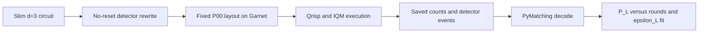

# DuQuantum: distance-3 surface code memory on IQM Garnet

We ran a distance-3 rotated surface-code Z-memory experiment (17 qubits, no mid-circuit reset) on IQM Garnet through Qrisp's `DetectorExperiment`, decoded it offline with PyMatching, and fitted the logical error rate per round. All numbers below come from files in `results/` and regenerate with `python analyze_hardware.py` followed by `python iqm_utils/d_analysis.py`.



## Results summary

| | |
|---|---|
| Device | IQM Garnet (20 qubits, 30 CZ couplers); calibration set `a18a947f` (Oct 24, 22:05–22:14 UTC) and `0fe32137` (E4, Oct 25, 12:20 UTC) |
| Layout | The only zero-SWAP placement on Garnet (patch P00); exactly 24 CZ per round, every CZ on a hardware coupler |
| Logical error per round, no DD | **ε_L = 0.102 ± 0.001** (bootstrap 95% CI [0.099, 0.106]), rounds 1–3, 15,000 shots each |
| Logical error per round, with DD | **ε_L = 0.065 ± 0.002** ([0.061, 0.068]), rounds 1–3 (matched to no DD), 5,000 shots each; 0.076 [0.074, 0.079] over rounds 1–5 |
| Drift replicate next day, no DD (E4) | ε_L = 0.070 ± 0.002 ([0.064, 0.075]), rounds 1–3, new calibration set |
| Main limit on ε_L | Gate and readout errors alone predict ε_L ≈ 0.012–0.015 (per-qubit and patch-averaged models), 7–8.5× below hardware; the gap is consistent with unmodeled idling and other device effects |

### Hardware data (decoded logical-error probability P_L)

| rounds | 1 | 2 | 3 | 4 | 5 |
|---|---|---|---|---|---|
| Zero-SWAP P00, no DD (E1+E2+E3 pooled, 15k shots) | 0.045 | 0.258 | 0.332 | 0.398 | 0.440 |
| Zero-SWAP P00, DD on (E2, 5k shots) | 0.040 | 0.127 | 0.210 | 0.271 | 0.335 |
| Naive layout + SWAP routing (E3, 5k shots) | 0.261 | 0.409 | 0.493 | 0.500 | 0.503 |
| Zero-SWAP P00, no DD, next day (E4, 5k shots) | 0.026 | 0.180 | 0.283 | 0.353 | 0.401 |
| Stim, Garnet gate + readout errors, no idling | 0.030 | 0.037 | 0.044 | 0.055 | 0.061 |
| Stim, uniform 0.3% | 0.002 | 0.005 | 0.006 | 0.008 | 0.010 |

Standard errors are 0.002–0.007. Fits use the model 2P = 1 − (1 − 2ε_L)^n and only points with P_L < 0.35. Without round 1 the fitted rates are 0.152 (no DD) and 0.085 (DD): a single ε_L does not describe round 1 well, because in the first round only the four Z-type ancillas give detectors and data qubits have idled least.

### Dynamical decoupling: paired E2 comparison

DD-on and DD-off circuits were interleaved by round count in E2, so each comparison has 5,000 shots and shares near-identical short-timescale drift.

| rounds | Delta P_L = DD − no DD | combined SE | z |
|---:|---:|---:|---:|
| 1 | −0.0090 | 0.0041 | −2.2 |
| 2 | −0.1256 | 0.0077 | −16.2 |
| 3 | −0.1158 | 0.0088 | −13.2 |
| 4 | −0.1184 | 0.0093 | −12.7 |
| 5 | −0.1046 | 0.0097 | −10.8 |

DD lowers decoded logical-error probability at all five round counts and exceeds the pre-specified two-standard-error threshold at all five. This meets the D7 criterion for a detectable DD effect. See `figures/dd_comparison.png`.

### Drift: E4 replicate on the next day's calibration

E4 repeated E1 about 14 hours later, after IQM recalibrated Garnet (`0fe32137`). P_L was lower at every round count (by 0.019, 0.078, 0.049, 0.045, 0.039; z = 4.9–12.0), and ε_L fell from 0.102 to 0.070. Patch-averaged calibration moved in mixed directions: CZ error rose from 0.62% to 1.25%, while readout error fell from 1.76% to 1.15% and T2 rose from 9.9 to 11.6 µs. The logical error rate improved despite worse CZ gates, which is consistent with readout and idling, rather than CZ error, dominating; with two calibration sets this is descriptive. See `results/tables/drift.csv`.

### Calibration-informed error-budget proxy

The P00 calibration snapshot was applied to the exact no-reset Stim circuit at its physical CZ pairs and qubits, then each modeled channel was independently set to zero. The calibrated baseline gives ε_L = 0.0121, only 0.118× the no-DD hardware estimate (0.1023), so calibrated gate/readout noise alone does not reproduce hardware within a factor of two. The independent ε_L drops are 0.00954 for CZ, 0.00552 for readout, and 0.00386 for single-qubit noise. These drops are not additive. Idle noise is not included or ablated because the calibration data does not provide the required gate or measurement durations. See `figures/error_budget_proxy.png` and `results/tables/error_budget_proxy.json`.

### By judging criterion

**1. Correctness and pipeline (30%).** The repository contains 70 verification tests covering deterministic noiseless detectors, circuit-level distance three, the no-reset rewrite, negative controls, Stim/Qrisp agreement, round trips, and a noiseless dry run through IQM's converter and result parser. Re-run them with `python -m pytest verification -q`. On hardware, raw counts are saved for every job and decoded events can be re-derived from them.

**2. Sophistication (30%).** A subgraph-isomorphism search (`layout.enumerate_patches`) proves Garnet has exactly one SWAP-free placement of the code. `layout.verify_layout` checks every transpiled circuit: zero SWAPs, only native PRX/CZ gates, all CZs on couplers, and exactly 24·rounds CZs. Merging single-qubit gates halves depth (53 vs 105 layers at five rounds) with the same CZ count. On hardware, a naive placement routed by IQM's router needs 54–93 extra CZs and raises round-one P_L from 0.040 to 0.261 in the interleaved E3 comparison.

**3. LER statistics (20%).** Within one calibration set, three no-DD replicates taken within ten minutes agree (rounds 1–3 fits 0.104, 0.104, 0.098). Across calibration sets they do not: the next-day replicate (E4) gives 0.070. Errors are binomial per point with 500-sample bootstrap intervals on ε_L. The fit is reported with and without round 1.

**4. Flexibility (20%).** Dynamical decoupling reduces P_L at two rounds from 0.253 to 0.127 and ε_L over rounds 1–3 from 0.102 to 0.065, measured with DD on and off interleaved by round count. Decoder-prior sensitivity (`noise_sweep.py`) and calibration-derived noise models (`iqm_utils/noise_for_patch.py`, `verification/score_patch.py`) are included.

**Bonus: what limits the LER.** The calibration-informed proxy ranks modeled CZ noise above readout and single-qubit noise, but its ε_L = 0.0121 is 8.5× below hardware (a patch-averaged uniform model gives 0.015, 7× below); it therefore cannot explain the observed logical error alone. The residual is consistent with unmodeled idling during mid-circuit readout and/or other device effects. DD reduces ε_L on matched rounds 1–3 by about 37% (0.102 to 0.065), consistent with an idling contribution, but idling was not measured directly and this is not causal proof. The hotspot map identifies QB15 as the largest bulk-detector anomaly (54.2% firing), yet eight ancillas are too few for causal inference: firing has Spearman ρ=0.119 with readout error (p=0.779) and ρ=0.333 with mean incident CZ error (p=0.420). See `figures/error_budget_proxy.png`, `figures/hotspot_map.png`, and `results/tables/hotspot_correlations.csv`.

### Limitations

- Two calibration sets only (one session of about ten minutes, plus the E4 replicate the next day); drift between them is large, so ε_L should be read as specific to a calibration set.
- Only one zero-SWAP patch exists on Garnet, so the planned patch-quality scan was replaced by the E3 layout-cost comparison.
- The calibrated simulation omits idle noise because gate and readout durations were unavailable.
- The default decoder prior is uniform 0.3%; a calibration-weighted decoder was not applied to hardware data.
- Hotspot correlations are descriptive only (n=8 ancillas); they do not establish a calibration-error cause.
- The error-budget proxy does not include or ablate idle noise because gate and measurement durations were unavailable; its independent channel drops are not additive.

### Reproduce

```bash
# Use Python 3.11–3.13; Qrisp 0.9.9 does not support Python 3.14.
pip install -r requirements.txt
python -m pytest verification -q          # verification, no hardware
python dryrun.py                           # noiseless run through IQM's converter, no hardware
python analyze_hardware.py                 # re-decode results/raw/, fits, tables, figures
python iqm_utils/d_analysis.py             # paired DD comparison and hotspot artifacts
python iqm_utils/reconcile_run_registry.py # run-status registry from saved results
python run_d6_error_budget.py              # calibrated, non-idle D6 proxy and error-budget figure
# hardware (needs IQM_TOKEN in the environment or .env):
python hw_setup.py garnet                  # backend facts and patch search, submits nothing
python run_experiments.py E1 E2 E3 E4      # run matrix (E4 = drift replicate)
```

### Code map

| File | Purpose |
|---|---|
| `surface_code.py`, `noreset_tools.py` | Stim circuit generation and the no-reset detector rewrite |
| `stim_to_qrisp.py` | Stim circuit to Qrisp `DetectorExperiment` |
| `layout.py` | Zero-SWAP patch search, fixed-layout pass, transpilation, `verify_layout` |
| `run_on_hardware.py` | Job submission, IQM post-processing, raw data saving and loading |
| `run_experiments.py` | Hardware run matrix with calibration snapshots |
| `analyze_hardware.py`, `iqm_utils/d_analysis.py` | Hardware decoding, fits, D5 hotspot map, and D7 DD comparison |
| `run_d6_error_budget.py`, `iqm_utils/calibrated_proxy.py` | Calibration-informed D6 proxy and independent channel ablations |
| `iqm_utils/reconcile_run_registry.py` | D4 status registry reconstructed from saved submitted results |
| `decode.py`, `noise_sweep.py` | MWPM decoding, epsilon_L fit and bootstrap, simulation baseline, prior sweep |
| `calibration.py`, `iqm_utils/noise_for_patch.py`, `verification/score_patch.py` | Calibration snapshots, calibration-derived noise, patch scoring |
| `results/` | Raw hardware data, tables, layout and backend facts |
